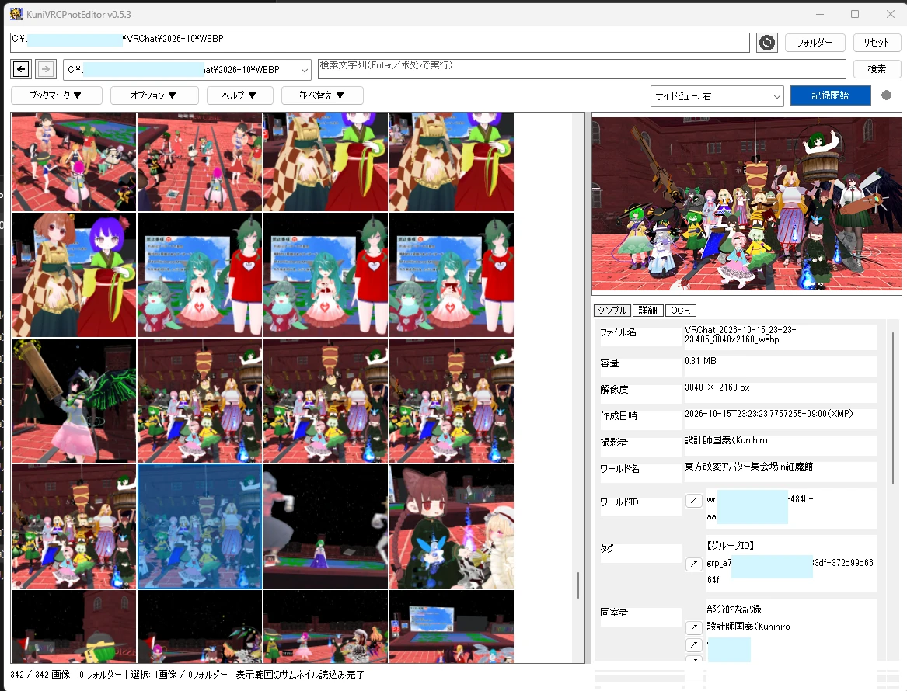

# KuniVRCPhotEditor

VRChat写真のメタデータを閲覧・編集し、新しい写真へ同室者情報やOCRによるモデル候補を記録するWindows用アプリです。本体は **v0.6.2**。Stableの配布版はファイル名の版番号を確認してください。

[簡単な使い方](Stable/readme.md) ｜ [詳しい使い方](Documents/USER_GUIDE.md) ｜ [更新履歴](Documents/UPDATELOG.md)

## UIsample

v0.5.3時点の画面です。現行版とは一部異なります。

## 動作環境・起動

Windows 10 1903以降／Windows 11のx64に対応します。Stable配下の配布ファイルを取得し、ZIPの場合は展開してください。版付きの `KuniVRCPhotEditor_vN.M.X.exe` を、書込み可能なフォルダーへ置いて起動します。設定・キャッシュ等はEXEと同じ場所へ保存します。Releaseは追加のWebPコーデックや専用DLLなしで動作します。OCRには利用可能なWindowsの言語モデルが必要です。

配布時は `THIRD_PARTY_NOTICES.md`、`libwebp-COPYING.txt`、`libwebp-PATENTS.txt` を同梱してください。ライセンスは［ヘルプ］→［ライセンス情報］でも確認できます。

## 主な機能

| 機能 | 内容 |
| --- | --- |
| 写真閲覧 | PNG／JPEG／WebPのサムネイル、プレビュー、Windowsフォト起動 |
| メタデータ編集 | 撮影日時・撮影者・ワールド・モデル・タグの表示／編集、複数画像の一括編集 |
| 整理・検索 | ファイル名／メタデータ検索、並べ替え、フォルダー履歴・ブックマーク |
| MDB | メタデータのローカルキャッシュ、人物・タグ・ワールド等の分類と折り畳み、人物の優先表示、IDと表示名の対応表 |
| 自動記録 | VRChatログから同室者・不足するワールド情報等を新規写真へ記録 |
| OCR | 画面内の名前を参加者と照合し、モデル候補を記録。画像・他ウィンドウでのテストにも対応 |
| 表示・保存 | タイル表示、ライト／ダーク、サイドビュー、バックアップ、サムネイルキャッシュ |

## 写真を開く・表示する

1. ［フォルダー］で写真フォルダーを選び、更新アイコンの［ロード］で一覧を読み込みます。直下の画像とサブフォルダーが表示されます。
2. 写真を選び、［シンプル］／［詳細］でメタデータを確認します。Ctrl＋ホイールで一覧サイズを変えられます。
3. ［詳細］の［編集］から変更し、上書きまたは別名コピーで保存します。複数選択時は一括編集できます。

検索は［検索］または検索欄のEnterで実行します。サブフォルダー内は検索しません。［ファイル名省略］をONにすると正方形タイル表示になります。操作・設定値・保存条件は[利用ガイド](Documents/USER_GUIDE.md)を参照してください。

## 人物記録・OCR

VRChatの［設定］→［Debug］→［Logging］を **Full**、カメラの **Save MetadataをON** にします。［オプション］→［記録設定］でログ／写真フォルダーを確認し、［記録開始］を押すと、新規PNG／JPEGへ情報を追記します。既存写真は自動変更しません。

［常駐モード］をONにするとVRChatの起動／終了に連動します。［常駐OCR］は次の記録開始からOCRを併用する設定です。ともに初期OFFです。ユーザーID保存は初期OFF、グループID保存は初期ONです。

## 注意点

- 自動記録は写真への上書きとAB_バックアップを伴います。手動上書きの自動バックアップも初期ONです。保存条件・上限整理は[バックアップ](Documents/USER_GUIDE.md#バックアップ)を確認してください。
- 同室者は写真に写った人物の確定一覧ではありません。OCR候補も推測で、距離・傾斜・見切れ・背景などに左右されます。実用性の評価は十分でなく、精度の追加改善は終了しています。共有前に人物情報・ID等の記録を確認してください。
- **本アプリではWindowsフォトによる同一ディレクトリ内の画像移動は実装していません。** 別画像は本アプリの一覧で選び直してください。
- MDBは初期OFFで、メタデータをローカルに保持し、外部送信しません。OFF適用時にDBを削除します。独立したID・表示名対応表は残ります。画像から対応表へ反映する操作は、確認後にバックアップなしで既存名も上書きします。
- EXIF回転・ICC色管理・DPI調整等には未対応事項があります。別PC・大量実写真の性能を含む[対応範囲と注意](Documents/USER_GUIDE.md#オプション注意点)を参照してください。

## 更新確認・関連文書

［ヘルプ］→［更新確認］から配布版を確認・取得できます。起動時も原則1日1回確認します。取得は了承後に行い、実行・展開・EXEの差替えは手動です。

[利用ガイド](Documents/USER_GUIDE.md) ｜ [Stable簡易手順](Stable/readme.md) ｜ [UPDATELOG](Documents/UPDATELOG.md) ｜ [開発・ビルド](Documents/DEVELOPMENT.md) ｜ [要件](Documents/VIEWER_REQUIREMENTS.md) ｜ [Stage4計画](Documents/KuniVRCPhotEditor_Stage4.md) ｜ [Stage5仕様](Documents/KuniVRCPhotEditor_Stage5.md) ｜ [第三者ライセンス](Documents/THIRD_PARTY_NOTICES.md)
